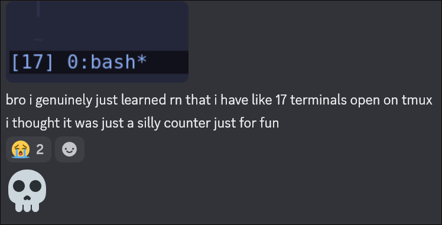

## new things i tried in 2026! 

2026 is my 2nd to 3rd year studying computer science. with my free time i love configuring my dotfiles and trying out new things! 
here are some highlights! 

### fish shell
when i was still using mint, i actually didn't use the terminal that much. but since switching to a tiling window manager, i started using the terminal a lot more. i still dont do very complicated commands but typing in bash is annoying, and i tried out [fish shell](https://fishshell.com/), which is a shell that gives autosuggestions/autocorrect based on your history.

### neovim
same as above, using neovim just looks cleaner on tiling wms. ive been meaning to learn neovim for probably a year or two now and it took me some time to get used to it. i turned my keybinds on VScode and LeetCode to be neovim, but the VScode's extension is very bad as in it's lowkey really janky idk. i had [kickstart nvim](https://github.com/nvim-lua/kickstart.nvim) forked and some color configs (lol) set up but it took me up until this semester to start using it. I'm currently taking this systems programming course which has us work on VMs you need to ssh into, and i know vscode has some ssh extension but i dont want to be relying on GUIs forever, so i just forced myself to start coding in nvim. 

like the way to start learning neovim is to just start using it even though the first month itll feel terrible to code.

### tmux
with using neovim you must use [tmux](https://github.com/tmux/tmux/wiki)!!! tmux pretty much allows you to open multiple windows within one terminal. So with using nvim you no longer can be focused on one file at a time, you dont need to wait for you AI agent to finish thinking before you and enter another command !! its very helpful and i just stole my boyfriends configs and started using it in like 10 seconds its very intuitive

### hyprland lua

pretty cool update! i think its cool that hyprlands on lua now to allow for more customization. i used codex to translate my conf files to lua and it did that pretty well. i tried around some new hyprland features but for rn depending on the feature some definietly make my computer a bit slower... also my GPU sucks so yea 

has anyone ever wanted raindrops on their terminal? also if youre using foot like me make sure you have `blur=yes` enabled... i didnt and i was acc really confused for like a while 

### GNOME
yeah unfortuantely before i switched to hyprland lua i didn't have time to update my computer that was 2 versions behind (fedora 42 -> 44) so i was using GNOME for a while

not much to say besides that its pretty solid but resource heavy

### AI tools
this year i also learned how to use AI a bit more. i mean AI was pretty good last year too but i wasn't really used to developing with it, even at my internship I was mostly just asking chatGPT questions with the chat, i really didn't use any tools that would have full context over the project. but its pretty good, Im using Codex and OpenCode (if youre an UIUC student you have free model credits for deepseek/qwen at ncsa btw!), and its definietly a skill that takes some time to learn: how to produce useful code and not just have it generate some working slop that doesn't work in the long run,,,